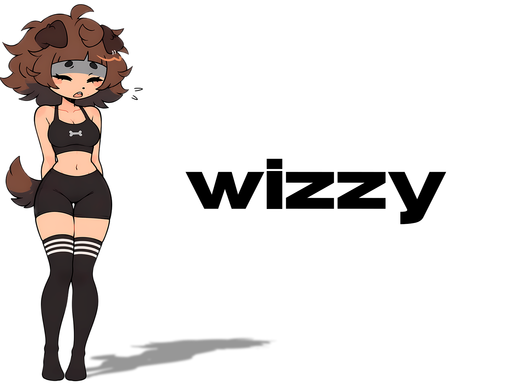

### about

делаю оверлеи, blender-аддоны и десктоп-приложения. люблю низкий уровень, но пишу быстро :)

---

### core skills

<table>
  <tr>
    <td align="center">
      &nbsp;&nbsp;
      &nbsp;&nbsp;
      &nbsp;&nbsp;
      &nbsp;&nbsp;
      &nbsp;&nbsp;
      &nbsp;&nbsp;
      &nbsp;&nbsp;
      
    </td>
  </tr>
</table>

- **languages:** C++ · C# · Python · TypeScript
- **graphics & gamedev:** HLSL · OpenGL · Unity · Win32 overlays
- **tooling:** Blender API · bpy · Electron · Vite
- **databases:** SQLite · JSON

---

### projects

<a href="https://github.com/w1zzyakik/OpenAnimEasy"><b>OpenAnimEasy</b></a> · free & open-source animation workflow addon for Blender 
<a href="https://github.com/w1zzyakik/MimiTap"><b>MimiTap</b></a> · overlay character on top of every window — click sync with sound (C#, Win32) 
<a href="https://github.com/w1zzyakik/nfc-prank"><b>nfc-prank</b></a> · NFC pranks, HTML
